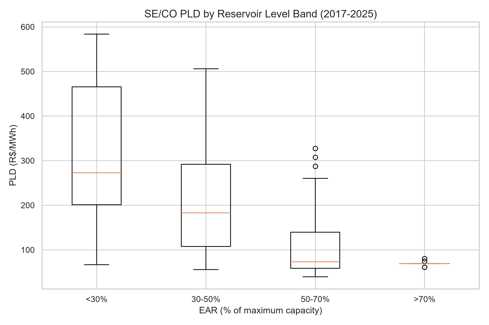
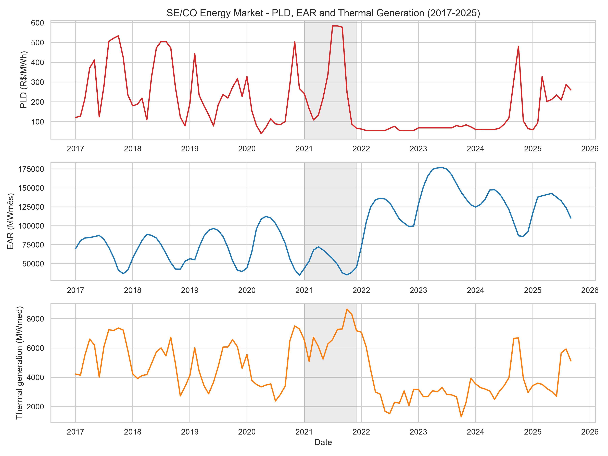
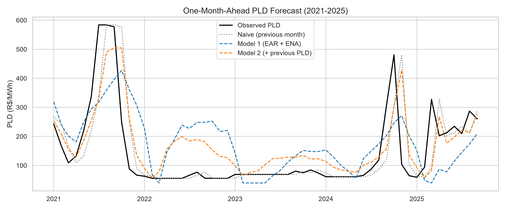

# What Drives Electricity Prices in the SE/CO Subsystem in Brazil's Free Energy Market? ⚡

[](https://www.python.org/)
[](https://pandas.pydata.org/)
[](#-key-findings)

> **TL;DR:** reservoir storage (EAR) and natural inflow (ENA) are clearly associated with the SE/CO spot price (PLD): prices are **61% higher** in the dry season and average **R$ 317/MWh** when reservoirs are below 30%, versus **R$ 69/MWh** above 70%. These variables explain the *level* of the price (adjusted R² of 0.42), but a simple one-month-ahead model **does not beat** repeating last month's price, because none of them anticipates the *timing* of price spikes.

## 📋 Business Context

The **PLD (Preço de Liquidação das Diferenças)** is the reference short-term price in Brazil's Free Energy Market (*Mercado Livre de Energia*). Understanding what moves it is critical for energy consumers, traders and anyone who manages energy contracts.

**Scope & focus:** to keep the analysis focused and robust, this study covers only the **Sudeste/Centro-Oeste (SE/CO)** submarket, which concentrates most of the reservoir storage capacity of Brazil's Interconnected National System (SIN). All variables (price, reservoirs, inflows, load and thermal generation) are filtered for SE/CO, so no national or other-region data is mixed into the analysis.

**Period:** January 2017 to September 2025, at monthly frequency (105 months). September 2025 is the last month available in the CCEE historical PLD file, which stopped being updated after the migration to the CCEE Open Data portal.

## ❓ Research Questions

1. Is the PLD in SE/CO significantly different between dry and wet hydrological periods?
2. How much of the PLD variation is explained by reservoir storage (EAR) and natural inflow (ENA), and do thermal dispatch and system load add explanatory power on top of them?
3. Can a simple regression model beat a naive forecast?

## 🔎 Key Findings

**Q1: Dry vs. wet periods.** The PLD is **61% higher** in the dry season (May-Nov) than in the wet season (Dec-Apr): mean of R$ 232.6 vs R$ 144.2/MWh (Mann-Whitney p = 0.007; 95% bootstrap CI for the difference: R$ 35.7 to R$ 141.0/MWh). The result holds when excluding 2022-2024 (+61.5%, p = 0.003).

**Reservoir level bands.** The PLD falls steadily as storage rises, and the bands are clearly different (Kruskal-Wallis p < 0.0001):

| EAR band | Months | Mean PLD (R$/MWh) | Median PLD (R$/MWh) |
|---|---|---|---|
| < 30% | 26 | 317.0 | 272.9 |
| 30-50% | 36 | 216.7 | 183.0 |
| 50-70% | 32 | 116.5 | 73.0 |
| > 70% | 11 | 69.1 | 69.0 |

The highest band sits at the regulatory price floor, so part of the contrast reflects the censoring of the price, not only supply and demand.

<p align="center"></p>

**Q2: Explanatory power.** EAR and ENA together explain about **42%** of the PLD variation (adjusted R² = 0.416; each +1,000 MWmês of EAR is associated with R$ 2.08/MWh lower PLD, and each +1,000 MWmed of ENA with R$ 2.93/MWh lower). Adding thermal dispatch and load raises it to **55%**, almost entirely due to thermal dispatch, which is a *consequence* of the price and therefore partly mechanical. System load adds nothing (p = 0.90). Excluding the floor years (2022-2024), the figures are **31%** and **42%**: the headline number is flattered by months in which a flat floor price coincides with full reservoirs.

<p align="center"></p>

**Q3: Forecasting.** A simple one-month-ahead regression does **not** beat the naive forecast (previous month's PLD) over 2021-2025:

| Model (walk-forward, 57 months) | MAE (R$/MWh) | RMSE (R$/MWh) |
|---|---|---|
| Naive (previous month) | 46.7 | 95.4 |
| Model 1: EAR + ENA (lag 1) | 104.6 | 128.4 |
| Model 2: previous PLD + EAR + ENA | 71.9 | 100.0 |

Excluding the floor years (21 months), adding EAR and ENA to the previous PLD improves the RMSE by **6.8%** (R$ 112.5 vs R$ 120.7), a marginal and statistically untested gain. EAR and ENA alone are clearly worse than the naive forecast. All models react to price spikes one month late instead of anticipating them.

<p align="center"></p>

**Correlations.** PLD vs. thermal dispatch: +0.71; vs. EAR: -0.56 (Pearson) and -0.62 (Spearman, which captures the non-linear, floor-driven relationship); vs. ENA: -0.38; vs. load: -0.25.

## 🗃️ Data Sources

| Variable | Source | Notes |
|---|---|---|
| PLD (target) | [CCEE Open Data](https://dadosabertos.ccee.org.br) | SE/CO submarket, monthly average, in R$/MWh |
| EAR (stored energy) | [ONS Open Data](https://dados.ons.org.br) | Daily, SE/CO subsystem, in MWmês (a stock); also available as % of maximum capacity. Aggregated to monthly mean |
| ENA (natural inflow) | [ONS Open Data](https://dados.ons.org.br) | Daily, SE/CO subsystem, gross inflow in MWmed (a flow). Aggregated to monthly mean |
| System load | [ONS Open Data](https://dados.ons.org.br) | Monthly, SE/CO subsystem, in MWmed |
| Thermal dispatch | [ONS Open Data](https://dados.ons.org.br) | SE/CO subsystem, programmed generation in MWmed, summed across plants. Aggregated to monthly mean |

Data downloaded on: `2026-11-09`

ONS data is licensed under CC-BY 4.0. Attribution: Operador Nacional do Sistema Elétrico (ONS) and Câmara de Comercialização de Energia Elétrica (CCEE).

**Expected files in `data/raw/`:**

```
data/raw/
├── Historico_do_Preco_Medio_Mensal.xls                         # CCEE (PLD)
├── CARGA_MENSAL.parquet                                        # ONS (load)
├── EAR/EAR_DIARIO_SUBSISTEMA_<year>.parquet                    # ONS, 2017-2025
├── ENA/ENA_DIARIO_SUBSISTEMA_<year>.parquet                    # ONS, 2017-2025
└── Thermal Generation/GERACAO_TERMICA_DESPACHO_<year>.parquet  # ONS, 2017-2025
```

The CCEE Excel file states that its updates through that channel ended on October 1; the same price history is available on the CCEE Open Data portal.

## 📁 Project Structure

```
energy-pld-analysis/
├── data/
│   ├── raw/          # Original files from CCEE and ONS, not edited (not tracked by git)
│   └── processed/    # Aligned monthly dataset generated by notebook 01 (not tracked by git)
├── notebooks/        # Step-by-step Jupyter notebooks (EDA, statistics, baseline model)
├── outputs/          # Exported charts used in this README
├── src/              # Reusable helper functions
├── requirements.txt
└── README.md
```

## 📊 Key Analytical Steps

1. **Data Engineering & EDA:** reading five independent sources, filtering SE/CO, converting non-numeric values and removing placeholder rows, aligning the time index (daily and monthly sources to a common monthly frequency), and Pearson/Spearman correlation analysis.
2. **Statistical Analysis:** hypothesis testing (Mann-Whitney for dry vs. wet periods, Kruskal-Wallis across EAR bands), bootstrap confidence intervals, and multiple linear regression (`statsmodels`, with autocorrelation-robust HAC standard errors) with a multicollinearity check (VIF). The regression is fitted first with EAR and ENA, then with thermal dispatch and load added, to measure the extra explanatory power. Robustness checks exclude the floor years (2022-2024).
3. **Baseline Forecasting Model:** one-month-ahead forecasts with a walk-forward (expanding window) evaluation from January 2021 on. Two linear regressions (EAR + ENA of the previous month; and the same plus the previous PLD) are compared against a naive forecast (previous month's PLD) using MAE and RMSE. Thermal dispatch is left out because it is not known before the price.

## ⚠️ Limitations

- The PLD has a regulatory **floor and ceiling** that change every year (for example, a structural ceiling of R$ 583.88/MWh in 2021 and floors of R$ 55.70, R$ 69.04 and R$ 61.07/MWh in 2022, 2023 and 2024, all visible in the data). Months at these limits do not reflect supply and demand, so the price is censored and a linear coefficient understates its relationship with EAR. The robustness checks exclude 2022-2024 as a block, which also removes some uncensored months (such as the late-2024 spike); flagging individual months at the limits is a natural improvement.
- Part of the data is **daily** (EAR, ENA and thermal dispatch) while the PLD and load are **monthly**, so everything is aligned to monthly frequency, which limits the number of observations (105 months in total).
- Before 2021 the PLD was set weekly by load level; only its monthly average is used here, so the analysis is not valid at finer time granularity.
- The regression R² values are **in-sample**. The out-of-sample evidence is the forecasting evaluation (Q3), which covers only 57 months (21 when the floor years are excluded), applies no significance test to the error differences, and shows that all models react to spikes one month late.
- Thermal dispatch is a **consequence** of the PLD (it follows the marginal cost of operation), so its association with the price is partly mechanical. It is used as a diagnostic in the explanatory model and left out of the forecasting model. It also uses the **programmed** dispatch, not the verified generation.
- The study looks at a single subsystem. Prices are coupled across submarkets, so flows to and from the South, Northeast and North are ignored, as are other drivers such as wind and solar generation and the fuel cost of thermal plants. These omissions help explain why a large share of the variation is left unexplained.
- Correlation does not imply causation. The models describe associations in historical data, not a causal mechanism.
- Hydrological series may be revised by ONS; results reflect the data on the download date above.

## 🚀 Getting Started

1. Clone the repository:

   ```bash
   git clone https://github.com/cesarmonteiro09/energy-pld-analysis.git
   cd energy-pld-analysis
   ```

2. Create and activate a virtual environment (Python 3.11+; developed with Python 3.15):

   ```powershell
   # Windows (PowerShell)
   python -m venv .venv
   .venv\Scripts\Activate.ps1
   ```

   ```bash
   # macOS / Linux
   python -m venv .venv
   source .venv/bin/activate
   ```

3. Install the dependencies:

   ```bash
   pip install -r requirements.txt
   ```

4. Download the raw datasets from the sources listed in [Data Sources](#️-data-sources) and place them in `data/raw/`, following the expected file layout shown there.

5. Run the notebooks in order (notebooks 02 and 03 read the dataset saved by notebook 01 in `data/processed/`):

   1. `notebooks/01_exploratory_data_analysis.ipynb`: data cleaning, alignment and exploratory analysis
   2. `notebooks/02_statistical_analysis.ipynb`: hypothesis tests, EAR level bands and regression (Q1 and Q2)
   3. `notebooks/03_baseline_model.ipynb`: one-month-ahead forecast vs. naive benchmark (Q3)

## 🗺️ Roadmap

- [x] Data cleaning, alignment and EDA (correlation matrices and time series)
- [x] Statistical tests and regression (Q1 and Q2)
- [x] Baseline forecasting model vs. naive benchmark (Q3)
- [ ] Flag the months at the regulatory floor and ceiling and use the flag in the robustness checks
- [ ] Test lagged relationships between PLD, EAR and ENA
- [ ] Test the significance of the forecast error differences and add a seasonal naive benchmark
- [ ] Add daily/hourly PLD to increase the number of observations
- [ ] Write the final storytelling (article) and publish the key findings
- [ ] Build a Power BI dashboard with the same data (Project 2)

## 📄 License and Attribution

Code: released under the MIT License (see `LICENSE`).
Data: CCEE and ONS open data (CC-BY 4.0 for ONS), used here for educational and portfolio purposes.

## 👤 Author

Built by [@cesarmonteiro09](https://github.com/cesarmonteiro09) as a data portfolio project. Feedback and suggestions are welcome through issues.
